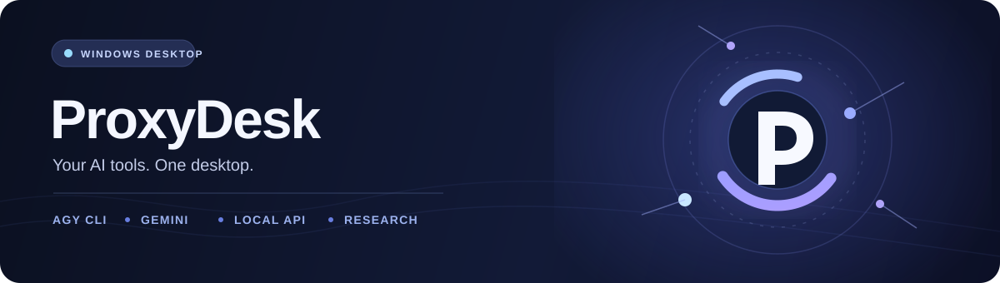
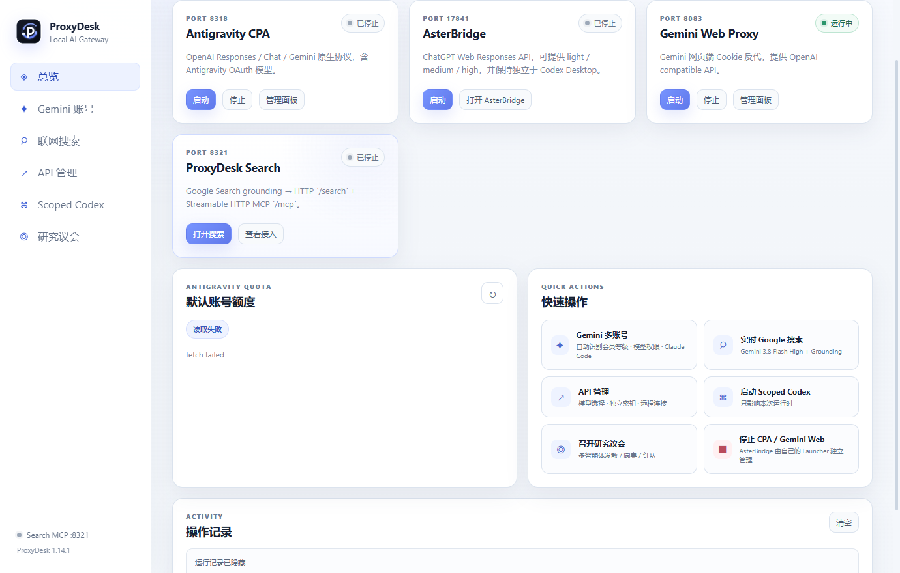
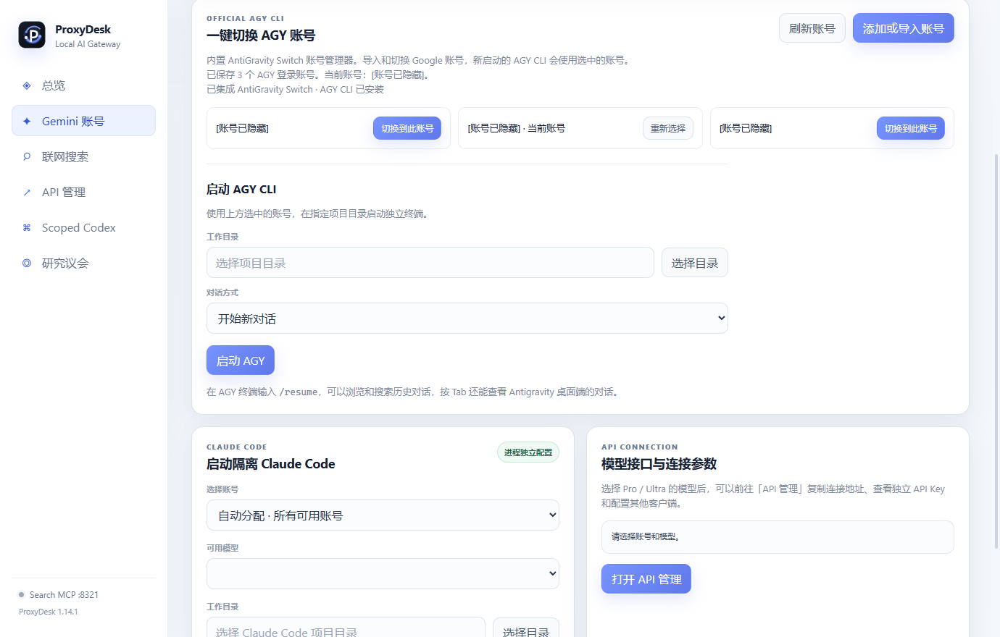
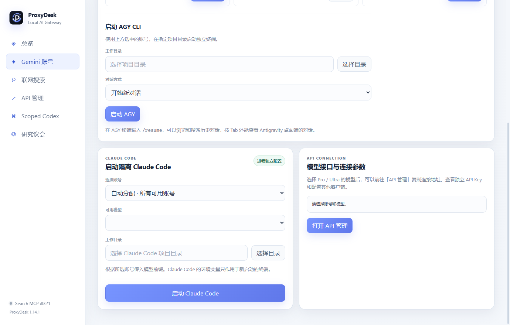
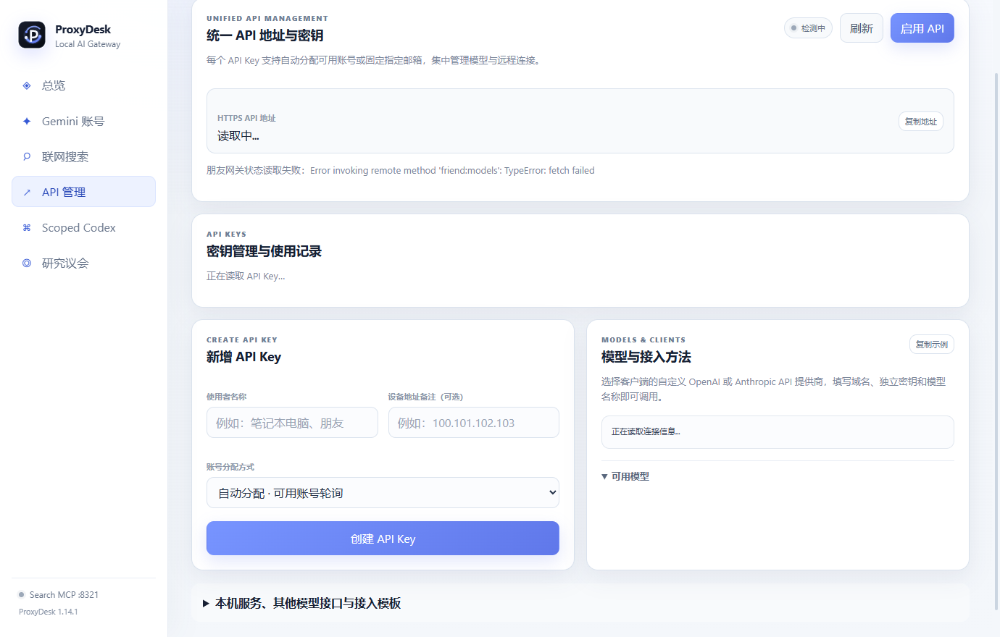
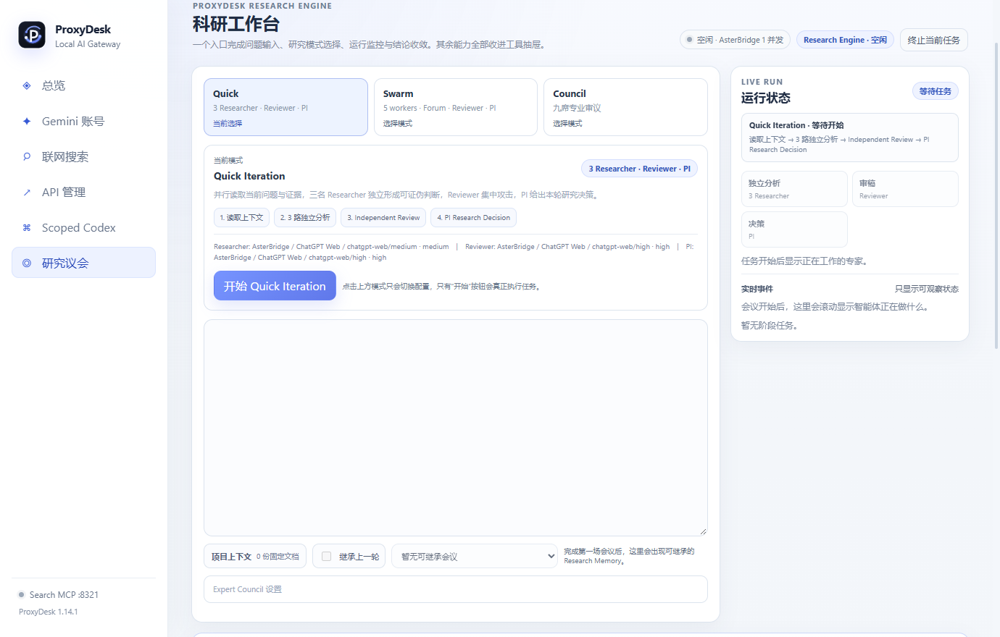
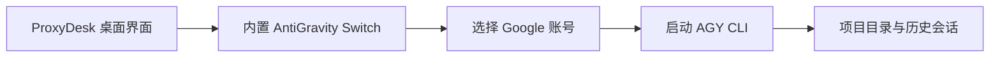

<div align="center">



<p><strong>一个桌面入口，管理 AGY 账号、启动 AI CLI、连接模型接口、组织自动科研。</strong></p>

<p>
  <a href="https://github.com/1210350468/ProxyDesk/releases/latest"></a>
  
  
  <a href="LICENSE"></a>
  <a href="https://github.com/1210350468/ProxyDesk/stargazers"></a>
</p>

<p>
  <a href="https://github.com/1210350468/ProxyDesk/releases/latest"></a>
  <a href="https://github.com/1210350468/ProxyDesk/releases"></a>
</p>

<p>
  <a href="#-核心功能">核心功能</a> ·
  <a href="#-实际界面">实际界面</a> ·
  <a href="#-三步开始使用">快速开始</a> ·
  <a href="#-运行环境与组件">运行环境</a> ·
  <a href="#-开发与构建">开发与构建</a> ·
  <a href="#-数据与许可证">许可证</a>
</p>

</div>

## 🖥️ 实际界面

下面的图片由 ProxyDesk 1.15.0 的真实 Electron 页面生成，公开展示时已隐藏本地账号、密钥和个人运行记录。

<p align="center">
  <a href="docs/screenshots/01-overview.png"></a>
  <br />
  <sub>桌面总览：服务状态、模型入口和快速操作</sub>
</p>

<table>
  <tr>
    <td width="50%" align="center" valign="top">
      <a href="docs/screenshots/02-agy-accounts.png"></a><br />
      <strong>AGY 账号管理</strong><br /><sub>导入账号 · 查看账号 · 一键切换</sub>
    </td>
    <td width="50%" align="center" valign="top">
      <a href="docs/screenshots/03-agy-launch.png"></a><br />
      <strong>AGY 一键启动</strong><br /><sub>选择项目目录 · 新建或恢复会话</sub>
    </td>
  </tr>
  <tr>
    <td width="50%" align="center" valign="top">
      <a href="docs/screenshots/04-api-management.png"></a><br />
      <strong>模型 API 管理</strong><br /><sub>独立客户端密钥 · 模型接入 · 使用记录</sub>
    </td>
    <td width="50%" align="center" valign="top">
      <a href="docs/screenshots/05-research-workbench.png"></a><br />
      <strong>多角色科研工作台</strong><br /><sub>Quick · Swarm · Expert Council</sub>
    </td>
  </tr>
</table>

📖 [查看完整功能导览与使用流程](docs/FEATURES.md)

## ✨ 核心功能

<table>
  <tr>
    <td width="50%" valign="top">
      <strong>🔄 AGY 多账号管理</strong><br />
      内置 <strong>AntiGravity Switch 4.10.18</strong>。添加 Google 账号、查看账号列表、手动切换 AGY 登录身份；通过内置管理器配置智能切换。
    </td>
    <td width="50%" valign="top">
      <strong>🚀 AGY 一键启动与会话恢复</strong><br />
      选择项目工作目录，启动新对话、继续最近对话，或通过会话 ID 恢复历史对话。首次使用时支持自动安装 Google 官方 AGY CLI。
    </td>
  </tr>
  <tr>
    <td width="50%" valign="top">
      <strong>💠 Gemini 账号与额度</strong><br />
      连接本机 CLIProxyAPI，管理 Google OAuth 账号，查看订阅等级、模型列表和额度信息。
    </td>
    <td width="50%" valign="top">
      <strong>🔌 本地 AI API 控制台</strong><br />
      集中查看模型接口，管理客户端 API Key、账号分配方式，以及搜索 HTTP / MCP 服务。
    </td>
  </tr>
  <tr>
    <td width="50%" valign="top">
      <strong>🧠 多角色自动科研</strong><br />
      Quick、Swarm、Expert Council 工作流程，包含任务进度、研究记录与 AsterBridge 集成。
    </td>
    <td width="50%" valign="top">
      <strong>🖥️ 中文桌面操作</strong><br />
      Electron 桌面界面集中提供账号、工作目录、启动方式与服务状态操作。
    </td>
  </tr>
</table>

## 🚀 三步开始使用

1. **下载安装。** 进入 [最新版本页面](https://github.com/1210350468/ProxyDesk/releases/latest)，下载 `ProxyDesk-1.15.1-portable.exe` 并打开。
2. **导入账号。** 进入「Gemini 账号」→「一键切换 AGY 账号」，点击「添加或导入账号」，使用自己的 Google 账号完成授权。
3. **启动项目。** 选择账号与工作目录，然后点击「启动 AGY」。程序检测 Google AGY CLI 的安装状态，首次使用时自动下载安装，并通过 Windows Terminal 打开交互式会话。

<p align="center"><strong>一个下载入口 · 内置账号管理器 · 自己的 Google 账号 · 指定目录开始工作</strong></p>

### 选择对话方式

| 操作 | 使用场景 |
| --- | --- |
| **开始新对话** | 在指定项目目录启动全新的 AGY 会话 |
| **继续最近对话** | 从该目录恢复最近一次会话，使用 `agy --continue` |
| **恢复指定会话** | 输入会话 ID，使用 `agy --conversation <会话ID>` |
| **浏览历史对话** | 在 AGY 终端使用 `/resume` 搜索并选择历史会话 |

### 账号切换如何工作



AGY 手动账号切换由 ProxyDesk 调用内置管理器完成。需要自动切换时，可以在 AntiGravity Switch 的设置中启用智能切换，并保持其桌面调度器运行。CPA 模型 API 的自动账号分配独立配置。

## 🧩 运行环境与组件

| 组件 | 获取方式 | 对应功能 |
| --- | --- | --- |
| **ProxyDesk** | 下载一个 Windows x64 便携程序 | 统一桌面入口 |
| **AntiGravity Switch 4.10.18** | **已经包含在便携版内** | 账号管理、切换与智能切换设置 |
| **Google AGY CLI** | 首次启动时调用 Google 官方安装程序 | AGY 交互式会话 |
| **Windows Terminal** | Windows 系统应用 | 显示 AGY 交互式终端 |
| **WebView2** | Windows 运行环境 | 显示 AntiGravity Switch 桌面界面 |
| **CLIProxyAPI / AsterBridge 等** | 根据使用功能单独配置 | 模型接口、网页代理、科研任务 |

<details>
<summary><strong>⚙️ 外部服务路径与 HTTPS 配置</strong></summary>

AGY 账号管理与启动功能可以独立使用。其他服务的默认路径由 ProxyDesk 安装目录的同级目录确定，也可以在启动前配置以下环境变量：

| 环境变量 | 功能 |
| --- | --- |
| `PROXYDESK_SERVICES_ROOT` | AntigravityProxy、GeminiWebProxy 的共同上级目录 |
| `PROXYDESK_CPA_ROOT` | 单独指定 CLIProxyAPI / AntigravityProxy 安装目录 |
| `PROXYDESK_WEB_ROOT` | 单独指定 GeminiWebProxy 安装目录 |
| `PROXYDESK_PUBLIC_BASE_URL` | 自己的 HTTPS 朋友 API 地址，如 `https://your-host.example/api/v1` |

例如：

```powershell
$env:PROXYDESK_SERVICES_ROOT = 'D:\Apps'
& 'D:\Apps\ProxyDesk\ProxyDesk-1.15.1-portable.exe'
```

朋友 API 通过配置自己的 HTTPS 反向代理，将 `/api` 转发至本机 `127.0.0.1:8338`。详情见 [API 管理文档](docs/API-MANAGEMENT.md)。

</details>

## 🛠️ 开发与构建

开发环境：Windows x64、Node.js、npm。

```powershell
git clone https://github.com/1210350468/ProxyDesk.git
cd ProxyDesk
npm ci
npm start
```

生成便携版及运行 AGY 真实启动检查：

```powershell
npm run dist
npm run check:agy-launch
```

检查命令会使用当前设备的 AGY 环境启动测试会话，验证终端窗口后关闭测试创建的 AGY 进程。需要实际模型 API 的其他测试使用本机授权与代理服务。

## 🔐 数据与许可证

Google 登录状态、API Key、运行日志与研究记录由当前设备保存。提交源码时请排除个人凭据、`.env`、本地代理配置和运行数据。

**ProxyDesk 自有源码**使用 [MIT 许可证](LICENSE)。内置的 **AntiGravity Switch 4.10.18** 来自 [anglee0323/agy-switch](https://github.com/anglee0323/agy-switch)，遵循 **CC BY-NC-SA 4.0**（署名、非商业性使用、相同方式共享），其 [原始许可证与署名](vendor/agy-switch/NOTICE.md) 随程序提供。Google AGY CLI 由 Google 官方安装程序下载。

<div align="center">

<sub>Made for a more connected AI desktop ✦</sub>

<p><a href="https://github.com/1210350468/ProxyDesk/releases/latest">下载最新版本</a> · <a href="https://github.com/1210350468/ProxyDesk/issues">提交问题</a> · <a href="https://github.com/1210350468/ProxyDesk/stargazers">Star on GitHub ⭐</a></p>

</div>
