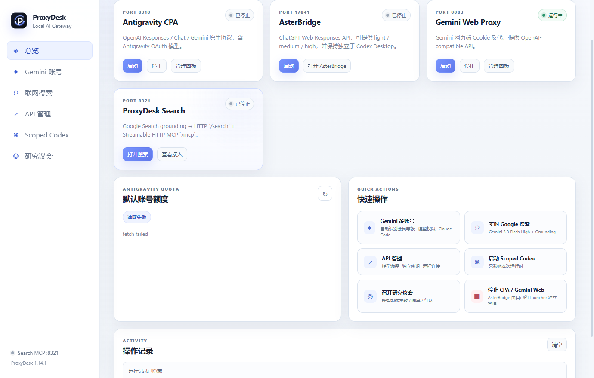
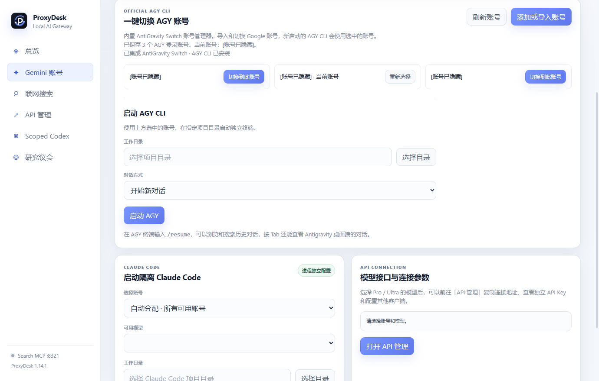
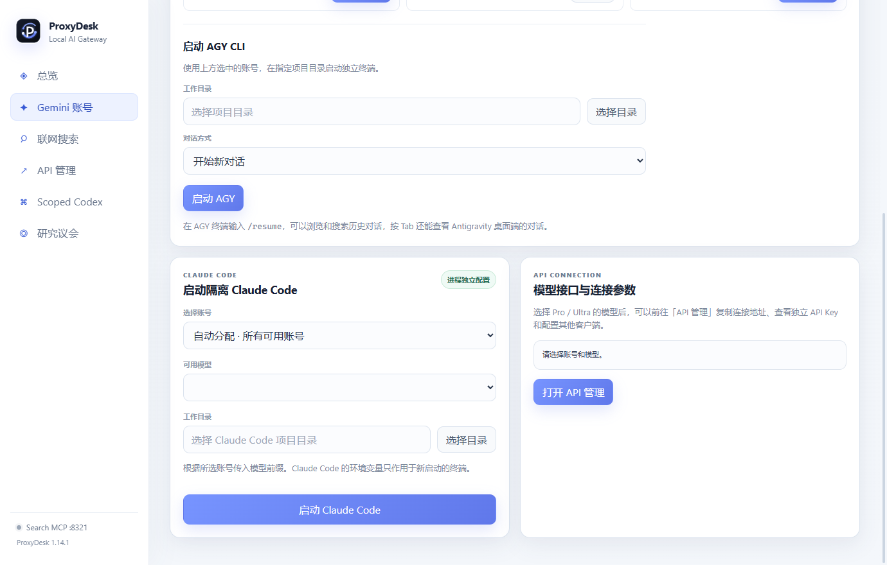
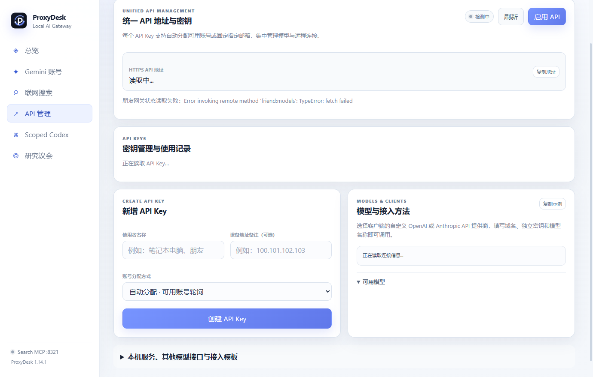
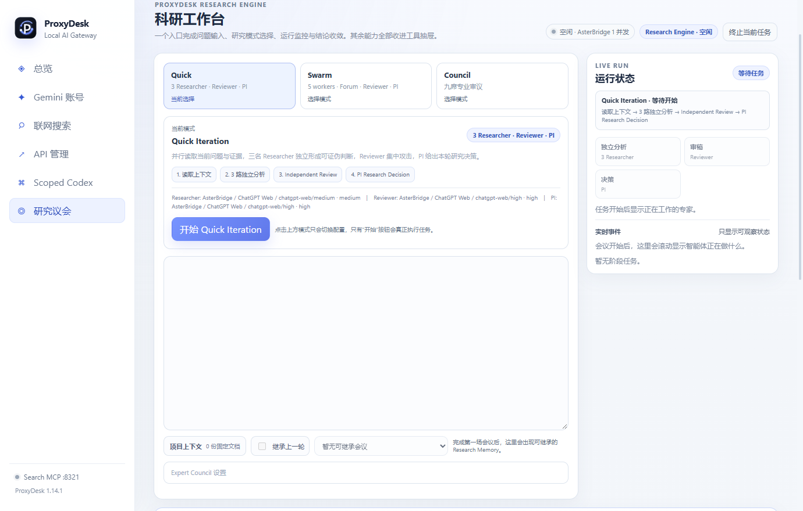

# ProxyDesk 功能导览

[← 返回项目首页](../README.md) · [下载最新 Windows 版本](https://github.com/1210350468/ProxyDesk/releases/latest)

以下截图来自 ProxyDesk 1.15.0 的实际桌面界面，使用独立截图配置生成，并隐藏个人账号、API Key、本地工作目录和个人研究内容。服务状态反映截图时的本机环境。

## 桌面总览



总览页面展示 Antigravity CPA、AsterBridge、Gemini Web Proxy 与 ProxyDesk Search 的服务状态，提供启动、停止、查看管理面板和进入其他功能的快捷操作。默认账号额度和快速操作也集中显示在这一页。

## AGY 账号管理



进入 **Gemini 账号 → 一键切换 AGY 账号**，点击「添加或导入账号」打开随 ProxyDesk 安装的 AntiGravity Switch 桌面管理器。导入自己的 Google 账号后，点击目标账号的切换按钮。当前选择适用于下一次启动的 AGY CLI 会话。

自动切换策略可以在 AntiGravity Switch 桌面管理器中配置。启用智能切换后，需要保持管理器的后台调度运行。

## 启动 AGY 与恢复会话



在同一页面中选择工作目录，并在下拉列表中选择开始新对话、继续最近对话或恢复指定会话，然后点击「启动 AGY」。系统在 Windows Terminal 打开独立 AGY CLI 会话；本机缺少官方 CLI 时会提供自动安装流程。

AGY CLI 内置 `/resume` 命令可浏览历史会话。

## 模型 API 管理



进入 **API 管理** 查看服务连接地址、客户端访问密钥、模型接入方式及使用记录。已有的 CLIProxyAPI、Gemini Web Proxy 和 AsterBridge 可通过对应安装目录与本地服务端口连接。朋友 API 功能需要用户配置自己的 HTTPS 访问地址。

## 多角色科研工作台



进入 **研究议会**，可以选择 Quick Iteration、Research Swarm 和 Expert Council。界面展示当前研究模式、参与角色、研究输入、阶段流程与运行监控；执行后可查看专家输出、研究决策和历史记录。

## 本地截图维护

开发者在 Windows 上安装 Node.js 与 npm，并完成 `npm ci` 后，可以执行以下命令重新抓取实际界面：

```powershell
npm run capture:readme
```

截图程序使用独立的本地运行配置，并自动隐藏截图中的账号、密钥和研究输入。文件保存至 `docs/screenshots/`。运行期间可以让正常使用的 ProxyDesk 保持打开。

[← 返回项目首页](../README.md)
